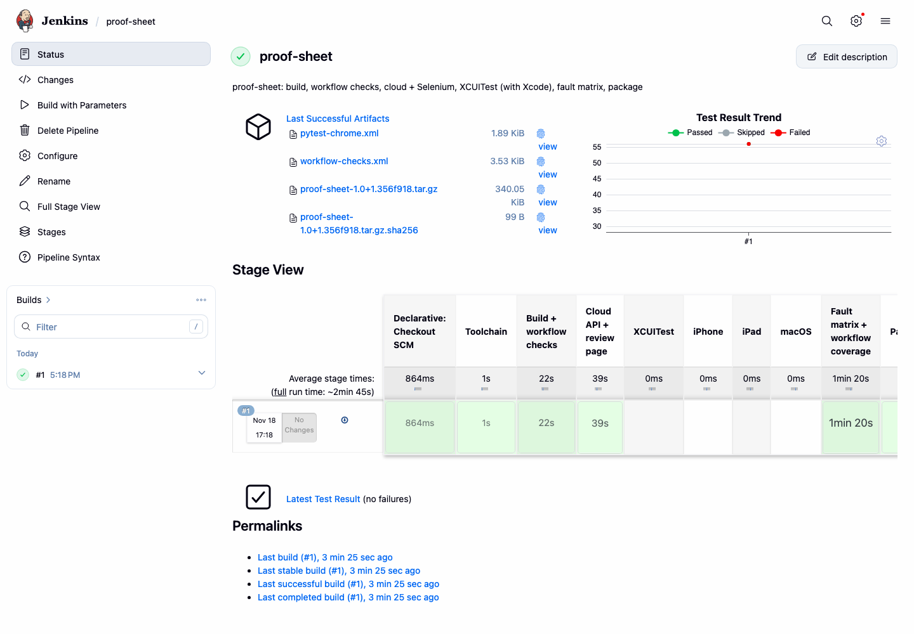
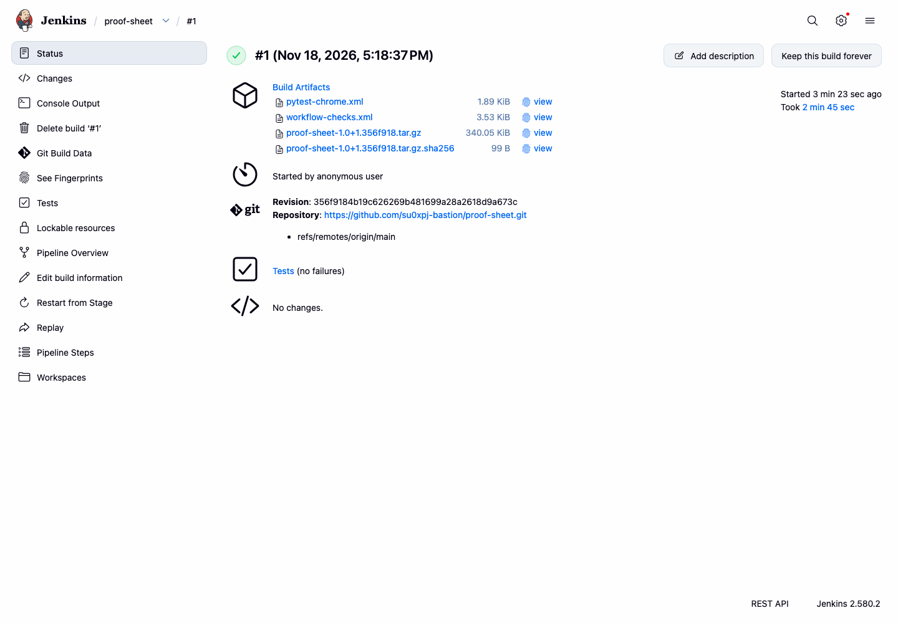
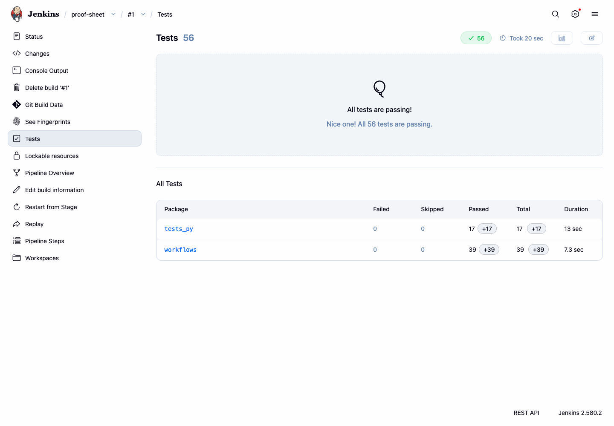

# The pipeline running on a real Jenkins

Build #1 of the `proof-sheet` job, on Jenkins 2.580.2 (LTS) on a MacBook, 2026-11-18.
The job checks out this repo from GitHub and runs the [Jenkinsfile](../../Jenkinsfile).

**Result:** SUCCESS in 2 min 45 s. 56 tests passed, 0 failed. Release bundle archived with a checksum and a fingerprint.

| Stage | Result | Time | What it did |
|---|---|---|---|
| Checkout SCM | ✅ | 1 s | cloned `main` from GitHub |
| Toolchain | ✅ | 1 s | detected the agent: Command Line Tools only, no Xcode |
| Build + workflow checks | ✅ | 22 s | built `ps` with `swiftc`; 39/39 workflow checks, published as JUnit |
| Cloud API + review page | ✅ | 39 s | 17 pytest tests: API contract, Selenium on Chrome, iPhone → Mac → web end-to-end |
| XCUITest (iPhone, iPad, macOS) | skipped | — | skipped on purpose: the `when` condition needs Xcode, which this agent doesn't have |
| Fault matrix + workflow coverage | ✅ | 1 min 20 s | every planted bug caught by exactly its pinned tests; 45/45 workflows covered |
| Package | ✅ | 15 s | `proof-sheet-1.0+1.356f918.tar.gz` (CLI, cloud service, docs, test reports, manifest) and its SHA-256 |







## What this shows

- **The same scripts everywhere.** This Jenkins pipeline and GitHub Actions call the same `scripts/ci/*.sh`, so a stage cannot pass in one system and fail in the other because of a script difference.
- **Honest skips.** On an agent without Xcode, the XCUITest stages are skipped by a `when` condition, and the log says why. They are not faked or silently passed. On an Xcode agent they run on iPhone, iPad and Mac, with a lock so two macOS UI runs never fight over the screen.
- **Delivery, not just integration.** The Package stage produces a versioned bundle named `version+build.commit`, with a manifest and a checksum, and Jenkins archives and fingerprints it. With Xcode, it also archives the macOS app (unsigned: signing and notarization need a team identity).
- **Results Jenkins understands.** Every workflow check and every pytest test is a JUnit test case, so trends and failures show per test.

## Run it yourself

```bash
ci/jenkins/run-local.sh                 # downloads Jenkins LTS, a JDK 21 and plugins into ~/jenkins-local
open http://127.0.0.1:8080/job/proof-sheet/
```

`ci/jenkins/setup.groovy` labels the machine `macos` and creates the pipeline job from GitHub.

Two things found while setting it up:
- Jenkins 2.580 needs Java 21. Java 20 is rejected, even with `--enable-future-java`. So the script fetches a JDK 21 just for Jenkins.
- macOS UI tests need a logged-in session, so a production agent runs as a LaunchAgent in the user session, not as a daemon.
